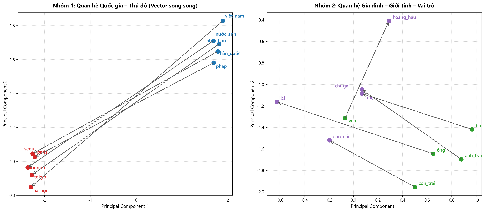

# Word embedding và trực quan hóa vector từ tiếng Việt

Dự án xây dựng mô hình word embedding Skip-gram từ đầu bằng PyTorch trên ngữ liệu tiếng Việt, sau đó trực quan hóa 10 cặp từ bằng thuật toán PCA để kiểm chứng tính chất hình học của không gian vector.

## Cấu trúc thư mục

```text
LLMHW_02/
├── preprocess.py          # Xử lý text tiếng Việt, tạo từ điển và dataset
├── model.py               # Kiến trúc mô hình Skip-gram PyTorch
├── train.py               # Huấn luyện mô hình và lưu checkpoint
├── evaluate.py            # Đánh giá độ tương đồng cosine và tra cứu từ
├── visualize.py           # Giảm chiều PCA và vẽ đồ thị 10 cặp từ
├── requirements.txt       # Danh sách thư viện cần thiết
├── vietnamese_word2vec.pt # File trọng số vector đã huấn luyện
└── word_vectors.png       # Hình ảnh trực quan hóa 10 cặp từ
```

## Cài đặt

Cài đặt các thư viện cần thiết qua pip:

```bash
pip install -r requirements.txt
```

Các thư viện sử dụng gồm `torch`, `numpy`, `scikit-learn` và `matplotlib`.

## Hướng dẫn sử dụng

### 1. Huấn luyện mô hình

Chạy script sau để huấn luyện từ đầu:

```bash
python train.py
```

Mô hình sử dụng kiến trúc Skip-gram với kích thước vector 50 chiều, cửa sổ ngữ cảnh bán kính 2, tối ưu bằng thuật toán Adam và hàm mất mát Cross-Entropy. Kết quả huấn luyện và từ điển được lưu tại `vietnamese_word2vec.pt`.

### 2. Đánh giá vector từ

Chạy file đánh giá để xem bảng độ tương đồng cosine giữa các cặp từ:

```bash
python evaluate.py
```

Tra cứu các từ tương đồng nhất với một từ bất kỳ:

```bash
python evaluate.py --word tokyo
```

Tính độ tương đồng cosine giữa hai từ cụ thể:

```bash
python evaluate.py --pair bố mẹ
```

### 3. Trực quan hóa 10 cặp từ

Chạy script giảm chiều và vẽ biểu đồ:

```bash
python visualize.py
```

Script sử dụng thuật toán PCA để giảm vector từ 50 chiều xuống 2 chiều và xuất file ảnh `word_vectors.png`.

## Kết quả thực nghiệm

### Độ tương đồng cosine giữa các cặp từ

| Từ 1 | Từ 2 | Cosine similarity | Nhóm quan hệ |
| :--- | :--- | :--- | :--- |
| hà_nội | paris | +0.9960 | Cùng nhóm thủ đô |
| tokyo | seoul | +0.9906 | Cung nhóm thủ đô |
| nhật_bản | hàn_quốc | +0.8652 | Cùng nhóm quốc gia |
| việt_nam | pháp | +0.8264 | Cùng nhóm quốc gia |
| bố | mẹ | +0.3985 | Gia đình |
| anh_trai | chị_gái | +0.3801 | Gia đình |
| ông | bà | +0.3240 | Gia đình |
| vua | hoàng_hậu | +0.2755 | Vai trò tương đương |
| việt_nam | bà | -0.0318 | Đối chứng, không liên quan |
| london | chị_gái | +0.1340 | Đối chứng, không liên quan |

Các từ cùng nhóm ngữ nghĩa và xuất hiện trong ngữ cảnh tương tự có độ tương đồng cosine cao hơn rõ rệt so với các cặp từ không liên quan.

### Biểu đồ trực quan hóa



Hai thành phần chính của PCA giữ lại 54.21% tổng phương sai của 20 từ.

* Ở nhóm 1 (Quốc gia - Thủ đô): Các vector nối từ quốc gia đến thủ đô có độ tương đồng cosine hướng trung bình đạt +0.9155 trong không gian 50 chiều và +0.9987 trên mặt phẳng 2D. Các mũi tên có hướng và độ dài gần như song song với nhau.
* Ở nhóm 2 (Gia đình - Vai trò): Các vector nối giữa các cặp đối xứng (nam sang nữ như bố sang mẹ, ông sang bà, anh trai sang chị gái) thể hiện hướng di chuyển đồng nhất từ phải sang trái.
